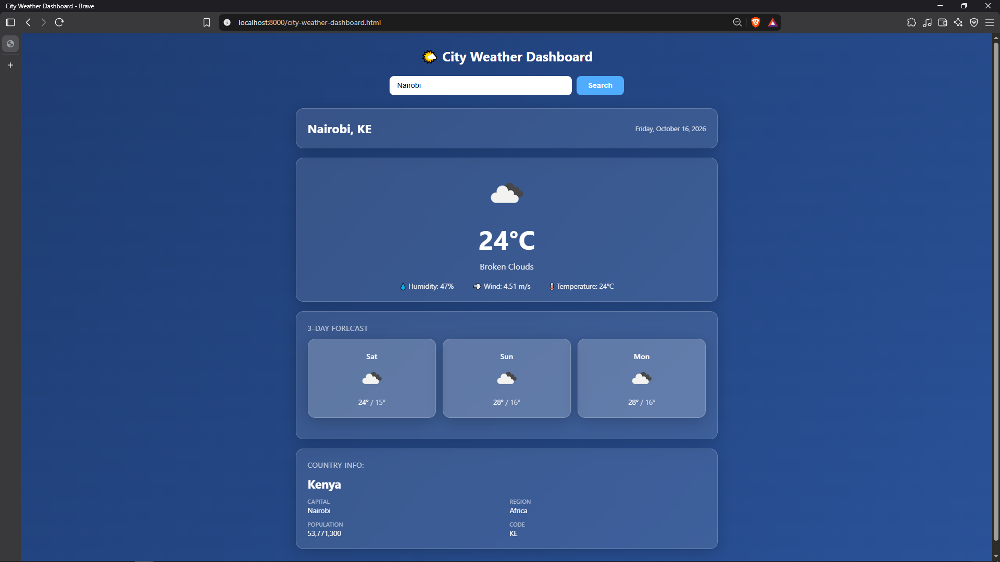

# 🌤️ City Weather Dashboard

A single-file HTML dashboard that shows current weather, a 3-day forecast,
and basic country info for any city in the world.



---

## Problem

A user wants to check a city's weather and basic country info without
opening multiple sites or apps. This dashboard delivers all of it in one
page from a single input.

---

## How it works

1. User enters a city name
2. **OpenWeatherMap** returns the current weather and a 5-day/3-hour forecast
3. The **country code** from the weather response is used to fetch
   country info (name, capital, region, population, flag)
4. All three sources are combined into a single dashboard

---

## APIs used

| API | Purpose | Endpoint |
|-----|---------|----------|
| OpenWeatherMap | Current weather | `/data/2.5/weather` |
| OpenWeatherMap | 3-day forecast | `/data/2.5/forecast` |
| countries.dev | Country info by ISO code | `/alpha/{code}` |

> **Note:** Migrated country lookup from REST Countries v3.1 (deprecated in 2024)
> to [countries.dev](https://countries.dev), a keyless mirror of the same schema.

---

## How to run

### 1. Get an OpenWeatherMap API key
Sign up for free at https://openweathermap.org/api — the key activates
within ~10 minutes of signup.

### 2. Add your key
Open `city-weather-dashboard.html` and replace:

```javascript
const API_KEY = "YOUR_OPENWEATHERMAP_KEY_HERE";
```

with your actual key.

### 3. Serve locally
```bash
python -m http.server 8000
```

Then open: `http://localhost:8000/city-weather-dashboard.html`

> **Why not open the file directly?** Some browsers block `fetch()` calls
> from `file://` URLs due to CORS. A local server avoids that entirely.

---

## Features

- **Loading state** shown while fetching data
- **Graceful error handling** for invalid cities, empty input, and network failures
- **Chained API calls** — country info depends on the weather response
- **Graceful degradation** — if the country API fails, the weather still renders
- **3-day forecast** grouped from 3-hour interval readings (skips today)
- **Clean, non-technical output** — icons, emojis, formatted population counts

---

## Tested cases

| Test | Result |
|------|--------|
| Valid city (`nairobi`, `london`) | ✅ Full dashboard renders |
| Invalid city (`xyzabc123`) | ✅ Clean error: "City not found (HTTP 404)" |
| Empty input | ✅ Prompts the user to enter a city |
| Country API failure | ✅ Weather still displays; country panel is hidden |

---

## Project structure

```
week1/
├── week1_project.html   # The dashboard (single file)
├── README.md            # This file
└── docs/
    └── preview.png      # Screenshot used above
```

---

## Tech stack

- **HTML5** — structure
- **CSS3** — glassmorphism dashboard styling
- **Vanilla JavaScript** — `fetch()` with `async/await`
- **No frameworks, no backend**

---

## Learning notes

This project was built as part of the AI-Masterclass Phase 1 weekly project.
Key lessons learned:

1. **Verify API response shapes before parsing.** Screenshots of raw
   responses (not docs) guided the field mappings.
2. **Parallel fetches** (`Promise.all`) for independent calls halve load time.
3. **Graceful degradation** — secondary data (country info) should never
   break the primary feature (weather).
4. **API deprecation is real.** REST Countries v3.1 was killed mid-project;
   migrating to a mirror was part of the exercise.

---

## License

MIT — free to use, modify, and share.

---

## Author

**Alois Mutharimi**
Data Analyst · AI Tools Builder
[LinkedIn](https://linkedin.com/in/aloismutharimi) · [GitHub](https://github.com/aloismutharimi)