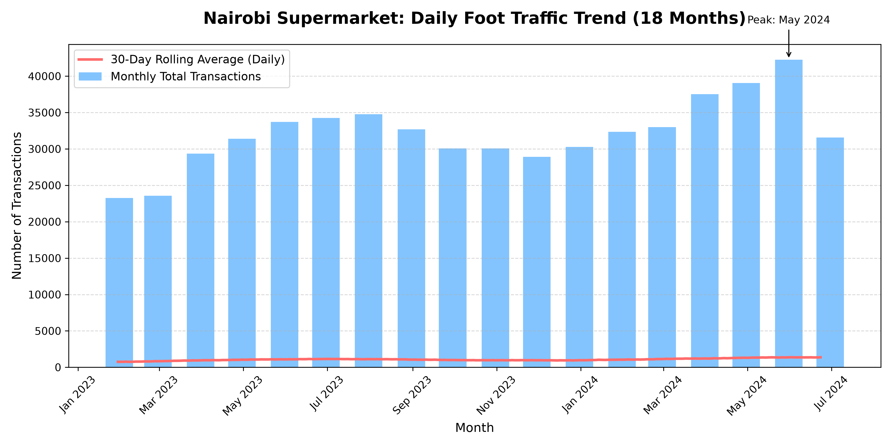

# Nairobi Supermarket — Foot Traffic Time Series Analysis

## What This Does
This script generates 18 months of simulated daily transaction data for a Nairobi supermarket chain, applying realistic seasonality (December spikes, February dips) and a gradual growth trend. It then plots the monthly totals alongside a 30-day rolling average to help management distinguish between genuine growth and normal seasonal fluctuations.

## How to Run
1. Install requirements: `pip install pandas numpy matplotlib`
2. Run the script: `python supermarket_traffic_analysis.py`
3. The script will save a chart named `traffic_trend.png` in the same folder.

## The Trend (Report for the Operations Manager)
> "Our data shows that overall foot traffic is steadily growing over the last 18 months, but the growth is masked by strong seasonal swings. December is consistently our peak month, while February experiences a significant dip; therefore, we should plan our staffing and inventory around these predictable seasonal patterns."

## Output Preview
